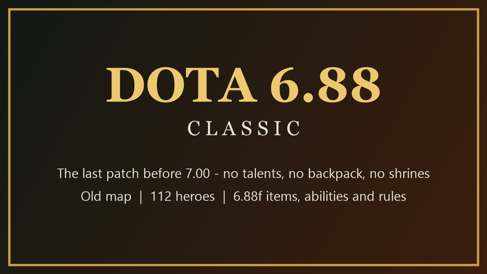
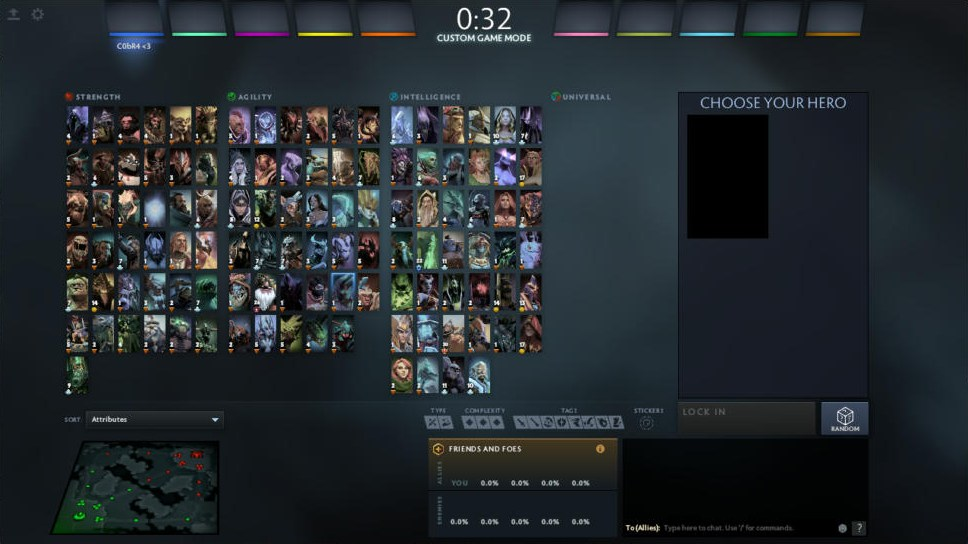
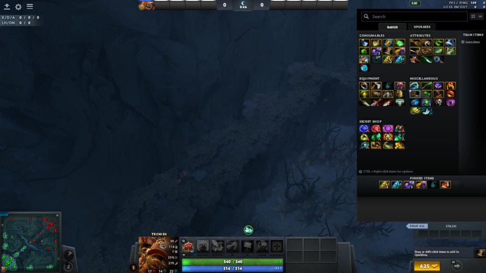
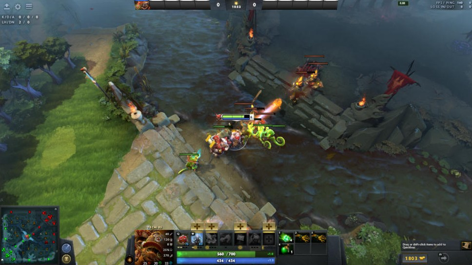
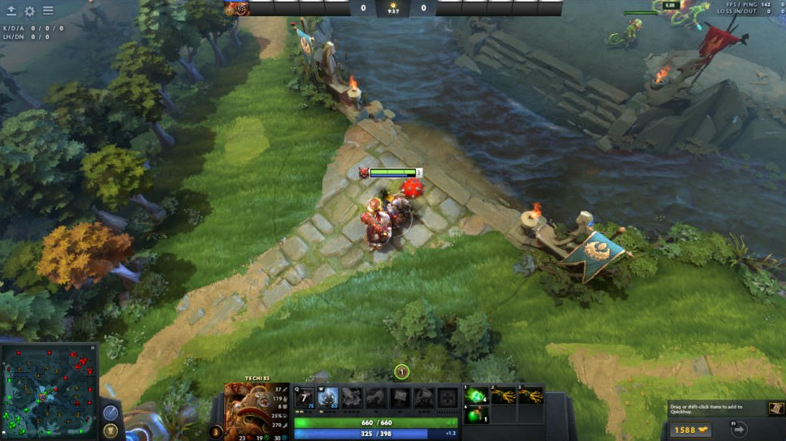

# Dota 6.88 Classic – Patch Notes

**Gameplay changes relative to the current Dota 2 client** (written the way Valve writes a gameplay patch,
but in reverse: everything that 7.00 and later changed is undone, back to **6.88f**, December 2016).

The addon runs on the current engine, so anything not listed here (interface, matchmaking, cosmetics,
engine fixes) stays as it is today. The exact numbers below come from Valve's original 6.88f game files
(`reference/6.88f/`) and from the 7.00+ changelogs; see `docs/REGULI_6.88.md` for every rule and its source.

**Full version with every hero and every item (pictures, values current → 6.88):** https://cobrabm12.github.io/Dota-workshopmap-beforepatch7/patchnotes/

| | |
|---|---|
|  |  |
|  |  |

---

## General

* **Talents removed.** The level 10/15/20/25 talent trees no longer exist; **Attribute Bonus** (+2 to all
  attributes, 10 levels) is back in every hero's ability bar.
* **Level cap is 25** (was 30). The XP curve is the 6.88 one: 200 / 500 / 900 / 1400 / 2000 / 2600 / 3400 /
  4400 / 5400 / 6000 / 8200 / 9000 / 10400 / 11900 / 13500 / 15200 / 17000 / 18900 / 20900 / 23000 / 25200 /
  27500 / 29900 / 32400 total XP for levels 2–25.
* **Ultimates are learned at levels 6 / 11 / 16** for all heroes.
* **Innate abilities and Facets removed.** Heroes have exactly the four (or more, for Invoker‑type kits)
  abilities they had in 6.88.
* **Backpack removed.** Inventory is 6 slots + stash; there is no TP‑scroll slot (a TP occupies a normal slot)
  and no neutral item slot.
* **Neutral items removed.** Neutral creeps drop nothing; there is no neutral stash and no Madstone / crafting.
* **Aghanim's Shard removed.** Aghanim's Scepter is a single item (no "Blessing" consumable); every hero
  gets the **6.88 Scepter upgrade**, not the current one (84 heroes had one in 6.88; Alchemist can give
  Scepter to allies, as he could then).
* **Day / night cycle is 4 + 4 minutes** (was 5 + 5). Night Stalker's Darkness and Luna's Eclipse change it as in 6.88.
* **Attribute values per point are the 6.88 ones:**
  * Strength: **+20 HP** (was 22) and **+0.03 HP regen** (was 0.1).
  * Agility: **+1/7 armor** (was 1/6), +1 attack speed.
  * Intelligence: +12 mana, **+0.04 mana regen** (was 0.05), **+1 % spell damage per 16 INT** (removed in 7.x), no magic resistance.
  * Base hero HP **200** and base mana **50** (were 120 / 75).
* **Armor formula** is unchanged (0.06·A / (1 + 0.06·|A|) – 7.27 returned to it).
* **Innate melee damage block removed** (the 7.23 50 % chance to block 16 damage). Only Stout Shield / Poor Man's Shield / Vanguard block.
* **Scan:** 270 s cooldown, one charge (as in 6.87/6.88).
* **Glyph of Fortification:** 5 seconds (7.x lengthened it), affects buildings only; 5 minute cooldown.
* **Random:** +200 gold for randoming a hero (6.88).
* **Fountain:** 4 % HP and 14 + 4 % mana per second (7.07 raised them to 5 % / 6 %).

## Economy

* **Starting gold 625**, passive gold **1 per 0.6 s** (100/min).
* **Hero kill bounty:** 110 + 9.9 × victim level (+ streak bonus 60…480), plus the 6.88 "assist" gold for
  every hero within 1300: 150 + 6L / 100 + 5L / 40 + 4L / 25 + 3L / 20 + 3L for 1–5 heroes. No networth‑based
  comeback multiplier on kills.
* **Death:** you lose **30 × level** unreliable gold (not the 7.x networth formula).
* **Respawn time: 5 + 3.8 × level** (8.8 s at level 1, 100 s at 25). No 26 s minimum for deaths to neutrals.
* **Buyback cost: 100 + 1.5 × level² + 0.25 × game seconds**; 7 minute cooldown; after buying back you
  earn 60 % less gold until your original respawn timer would have ended.
* **Towers give team gold: 160 / 200 / 240 / 280** (tier 1–4) to every player, plus a reliable last‑hit
  bounty; denying a tower gives the enemy team only half. **Barracks: 275 melee / 225 ranged** team gold.
* **Roshan: 200 gold to every player** on the killing team (plus the last‑hit bounty); Aegis, and **Cheese
  from the third death on**.
* **Creep XP** is shared within **1300** range; denied creeps give the enemy 50 % XP; a creep killed by
  neutrals gives 35 % XP. Lane creeps gain **+12 HP / +2 gold every 7:30**; a siege creep comes with every
  7th wave.
* **Backdoor protection: 25 % damage reduction** (the engine's 50 % is corrected), as in 6.88.

## Map

The **original 6.88 map** (decompiled from the December 2016 client and recompiled for the current engine):

* No shrines, outposts, Tormentors, Lotus Pools, Twin Gates, Watchers, Wisdom runes or Water runes.
* The old lane / jungle layout, Roshan pit on the Dire side of the river, both side shops and both secret shops,
  the old tree lines, the old rune spots.
* **Runes:** two spots in the river, spawning every 2 minutes from 0:00. At 0:00 both are Bounty runes; after that
  one Bounty rune and one power rune (Double Damage, Haste, Illusion, Invisibility, Regeneration – no Arcane).
  Bounty rune: 50 + 2/min gold and 50 + 5/min XP **to the player who picks it up only**.
* **Neutral camps spawn at 0:30**, then every minute; no camp "stacking" by anyone but players (the 7.x
  automatic stacking is disabled). Ancient camps are spell immune.
* **Towers:** tier 1 1300 HP / 20 armor / 100–120 damage, tier 2–4 122–182 damage; **Tower Protection
  aura** (+1 armor near tier 1, +3 near tier 2–4) instead of the 7.x regeneration aura; no tower
  "fortification" at the horn.
* **Ancient:** 4250 HP, 15 armor. **Roshan:** 8000 HP, 5 armor, grows by +700 HP / +10 damage / +0.7 armor
  every 4 minutes.
* **Courier: unchanged from the current Dota 2** (deliberate exception to 6.88): every player gets a free personal
  courier, as in the latest patch. Animal Courier / Flying Courier are not in the shop.

## Items

* **72 items added after 6.88 are removed from the shop:** Aghanim's Shard, Blood Grenade, Crown, Diadem,
  Blitz Knuckles, Voodoo Mask, Shawl, Ring of Tarrasque, Tiara of Selemene, Fluffy Hat, Wizard Hat, Splintmail,
  Phylactery, Angel's Demise, Witch Blade, Holy Locket, Wind Waker, Meteor Hammer, Nullifier, Aeon Disk, Kaya,
  Kaya and Sange, Yasha and Kaya, Spirit Vessel, Essence Distiller, Consecrated Wraps, Crella's Crozier, Helm of
  the Overlord, Gleipnir, Disperser, Orb of Corrosion, Orb of Frost, Falcon Blade, Mage Slayer, Boots of Bearing,
  Pavise, Revenant's Brooch, Devastator, Harpoon, Specialist's Array, Hydra's Breath, Chasm Stone, Caster Rapier,
  Overwhelming / Swift / Arcane Blink, Aghanim's Scepter (consumable) and their recipes.
* The shop uses the **6.88 layout** (Consumables / Attributes / Equipment / Miscellaneous / Secret Shop) and
  **6.88 prices, recipes and stats for all 303 items**. Highlights of items whose mechanics changed after 6.88
  and are back to the original:
  * **Iron Talon** (back; 40 % of a creep's HP), **Poor Man's Shield**, **Ring of Aquila**, **Ring of Basilius** (armor
    aura does not stack with Vladmir's), **Necronomicon**, **Shadow Amulet**, **Tango** (125 gold, 4 charges).
  * **Boots of Travel** teleport to units; **Phase Boots** +24 damage, no armor; **Power Treads** +9 to the chosen stat;
    **Tranquil Boots** with the 6.88 break rules.
  * **Force Staff** 600 push, **Hurricane Pike** (+100 attack speed only during the active).
  * **Battle Fury** 35 % cleave in a 280 radius, quell; **Monkey King Bar** 35 % chance for 100 bonus damage and
    a mini‑stun; **Desolator** −7 armor; **Diffusal Blade** 2 levels, mana burn on attack, purge with charges.
  * **Mekansm** 250 heal / +2 armor with a 25 s no‑stack rule; **Guardian Greaves**; **Pipe** 400 barrier;
    **Crimson Guard** heroes only, 50 s lockout; **Vladmir's** 15 % lifesteal aura.
  * **Heart of Tarrasque** 4.75 % HP/s regen out of combat; **Satanic** 25 % lifesteal, Unholy Rage +175 %;
    **Eye of Skadi** slow 35 %; **Sange and Yasha**; **Heaven's Halberd** disarm 3 / 5 s.
  * **Bloodstone** 12 charges, +1 mana/s per charge, −3 s respawn per charge, heals allies on death, loses a
    third of its charges; **Octarine Core** 25 % cooldown reduction, spell lifesteal 25 % / 5 %.
  * **Linken's Sphere** with **Transfer Spellblock**; **Lotus Orb** reflects targeted spells and item spells;
    **Scythe of Vyse** 3.5 s hex, destroys illusions; **Orchid** / **Bloodthorn** (145 % crit + True Strike on the
    silenced target).
  * **Aghanim's Scepter** 4200 gold with the 6.88 recipe (Point Booster + Ogre Axe + Blade of Alacrity + Staff of
    Wizardry), no Shard upgrades.
  * **Urn of Shadows** (starts empty, +2/+1 charges to the closest Urn only), **Medallion of Courage** and
    **Solar Crest** with evasion/miss, **Veil of Discord** −25 % magic resistance, **Rod of Atos**, **Dagon 1–5**,
    **Ethereal Blade** (2 × primary attribute + 75), **Silver Edge**, **Glimmer Cape**, **Echo Sabre**, **Abyssal Blade**
    (bash does not stack with Skull Basher / innate bashes).
* **Damage block, lifesteal and armor auras follow the 6.88 stacking rules** (only the highest applies).
* **Unique Attack Modifiers (orb effects) follow the 6.88 rules:** only one applies per attack. Priority: a
  Maelstrom / Mjollnir Chain Lightning proc, then the hero's own orb (Mana Break, Frost Arrows, Liquid Fire, Arcane
  Orb, Caustic Finale), then the oldest item (Morbid Mask, Mask of Madness, Satanic, Helm of the Dominator,
  Desolator, Blight Stone, Eye of Skadi). Eye of Skadi works together with lifesteal and with Liquid Fire; on
  buildings, where lifesteal and Skadi do nothing, Desolator applies.
* **River Vials** are removed from the shop: in 6.88 they needed the 2016 Battle Pass and cannot be bought here.

## Heroes

* **15 heroes added after 6.88 are disabled:** Monkey King, Dark Willow, Pangolier, Grimstroke, Mars, Void Spirit,
  Snapfire, Hoodwink, Dawnbreaker, Marci, Primal Beast, Muerta, Ringmaster, Kez, Largo.
* **All 112 heroes of 6.88f** use their 6.88 base stats, attribute growth, movement speed, attack range,
  base armor and the **6.88 ability kits** (530 abilities with 6.88 cooldowns, mana costs, damage, durations,
  ranges and scaling).
* **Abilities reworked after 6.88 are rewritten with their original mechanics** – a selection:
  * **Techies:** Land Mines, Stasis Trap, Suicide Squad, Attack! (50 % respawn time), Remote Mines (with the
    6.88 Scepter radius / damage), Focused Detonate, Minefield Sign.
  * **Riki:** Permanent Invisibility (ultimate) with Backstab, Blink Strike, Smoke Screen, Tricks of the Trade
    (hits every enemy in range, from behind, once per second).
  * **Lycan:** Howl; **Treant:** Nature's Guise, Leech Seed, Living Armor, Eyes in the Forest; **Necrophos:**
    Sadist, Reaper's Scythe with extra respawn time; **Viper:** Nethertoxin, Poison Attack; **Io:** Overcharge;
    **Outworld Devourer:** Arcane Orb, Essence Aura, Sanity's Eclipse; **Pudge:** Meat Hook, Flesh Heap;
    **Slardar:** Sprint, Bash; **Sven:** Warcry; **Tiny:** Toss, Craggy Exterior, Grow; **Undying:** Flesh Golem;
    **Visage:** Gravekeeper's Cloak; **Wraith King:** Vampiric Aura, Mortal Strike, Reincarnation.
  * **Faceless Void:** Time Lock, Time Dilation; **Enigma:** Demonic Conversion, Midnight Pulse, Black Hole;
    **Bane:** Nightmare, Enfeeble, Fiend's Grip; **Brewmaster:** Drunken Haze, Drunken Brawler;
    **Broodmother:** Spin Web; **Bounty Hunter:** Shuriken Toss, Jinada, Shadow Walk, Track;
    **Bloodseeker:** Bloodrage, Thirst, Rupture; **Beastmaster:** Call of the Wild, Inner Beast;
    **Chen:** Penitence, Test of Faith, Holy Persuasion; **Legion Commander:** Overwhelming Odds, Press the
    Attack, Moment of Courage, Duel; **Lifestealer:** Rage, Feast; **Keeper of the Light:** Chakra Magic,
    Blinding Light, Spirit Form; **Gyrocopter:** Call Down; **Invoker:** Invoke and the 6.88 orb levels;
    **Lone Druid:** Spirit Bear, True Form, Battle Cry; **Morphling:** Adaptive Strike, Morph, Replicate, Hybrid;
    **Naga Siren:** Rip Tide, Song of the Siren; **Omniknight:** Repel, Degen Aura, Guardian Angel;
    **Troll Warlord:** Berserker's Rage, Battle Trance; **Nyx:** Mana Burn; **Ogre Magi:** Multicast with
    Fireblast / Ignite / Bloodlust / Unrefined Fireblast; **Medusa:** Mana Shield; **Mirana:** Starstorm, Leap;
    **Sniper:** Take Aim, Assassinate (2 s aim, mini‑stun); **Zeus:** Static Field, Thundergod's Wrath;
    **Slark:** Essence Shift, Shadow Dance; **Sand King:** Burrowstrike, Sand Storm, Caustic Finale;
    **Tidehunter:** Anchor Smash; **Tinker:** Laser, Heat‑Seeking Missile, Rearm; **Terrorblade:**
    Reflection; **Rubick:** Fade Bolt, Null Field; **Shadow Fiend:** Necromastery, Requiem of Souls;
    **Luna:** Lunar Blessing, Eclipse (no stun, turns day into night); **Juggernaut:** Omnislash (200–225 per
    slash, 3/6/9 slashes, items usable); **Huskar:** Berserker's Blood (linear), Life Break (spell immune while
    leaping); **Kunkka:** Ghostship (ship spawns behind Kunkka), Rum; **Lich:** Chain Frost (10 jumps,
    no zombie bounces), Dark Ritual; **Lina:** Fiery Soul, Laguna Blade; **Lion:** Finger of Death;
    **Magnus:** Empower; **Meepo:** Geostrike; **Night Stalker:** Crippling Fear, Hunter in the Night, Darkness; **Dazzle:**
    Poison Touch, Weave; **Death Prophet:** Silence; **Disruptor:** Static Storm; **Doom:** Doom;
    **Dragon Knight:** Dragon Blood; **Drow Ranger:** Marksmanship, Precision Aura; **Elder Titan:** Earth
    Splitter; **Crystal Maiden:** Brilliance Aura, Freezing Field; **Clinkz:** Strafe, Death Pact;
    **Chaos Knight:** Chaos Strike, Reality Rift; **Centaur:** Return, Stampede; **Bristleback:** Viscous
    Nasal Goo, Warpath; **Axe:** Counter Helix, Culling Blade; **Ancient Apparition:** Chilling Touch, Ice
    Blast; **Alchemist:** Greevil's Greed; **Abaddon:** Curse of Avernus, Borrowed Time; **Vengeful Spirit:**
    Vengeance Aura (negative aura on her killer), Nether Swap; **Venomancer:** Poison Nova; **Windranger:**
    Windrun, Focus Fire; **Storm Spirit:** Electric Vortex; **Spirit Breaker:** Empowering Haste, Nether
    Strike; **Skywrath Mage:** Mystic Flare; **Silencer:** Glaives of Wisdom, Last Word; **Razor:** Unstable
    Current, Eye of the Storm; **Pugna:** Decrepify, Life Drain; **Puck:** Dream Coil; **Queen of Pain:**
    Sonic Wave; **Phantom Assassin:** Blur; **Oracle:** Purifying Flames; **Tusk:** Walrus Punch; **Ursa:**
    Enrage; **Shadow Demon:** Soul Catcher; **Leshrac:** Pulse Nova; **Jakiro:** Macropyre.
  * The full list (191 abilities, 76 items) is in `docs/STATUS.md`; per‑hero Scepter upgrades are in `docs/AGHANIM.md`.
* **Built‑in abilities that gained new mechanics after 6.88 have them disabled** (187 overrides): e.g. Anti‑Mage's
  Mana Break has no mana burn amplification, Necrophos' Heartstopper Aura, Templar Assassin's Psionic Trap,
  Culling Blade's threshold, Invoker's spells, consumables and more use their 6.88 behaviour.
* **No ability scales with hero level** (current passives such as Desolate, Poison Sting, Hunter in the Night and
  Stone Remnant charges grow with hero level; here they use their 6.88 per‑level values only).
* **6.88 details restored on built‑in abilities:** Morph passively grants +3/4/5/6 Agility and Strength; Serpent Wards
  deal 40–45 / 60–65 / 80–85 damage with splash; Phantom Strike's attack speed lasts at most 4 attacks; Corrosive Skin
  also slows movement (1400 range); Thunder Clap slows creeps for 8 s and Reverse Polarity stuns creeps for 3/4/5 s;
  the Earth Brewling is immune to spells; Stifling Dagger crits with Coup de Grace's 15 % chance.
* **Modern additions removed:** Glimpse damage, Double Edge Strength damage, Shockwave slow and pull, Skeleton Walk
  skeletons, Spell Steal cooldown reduction, Lycan wolf bash, golem slow resistance, Brawler on brewlings, Death Ward
  bonus range, Mystic Snake slow, spiderling bonus damage, Roshan's status and slow resistance, Arcane Boots' mana aura.

## Not changed (engine limitations, documented)

* The movement speed cap stays 550 in the engine (6.88: 522); no 6.88 source reaches it in practice.
* The 6.82–6.88 networth "comeback" component of kill gold and the 6.88 illusion kill bounty rules are
  approximated (see `docs/REGULI_6.88.md`, marked TODO).
* Lone Druid's bear leash (Scepter) is in C++ and cannot be reproduced.
* A Chain Lightning proc cannot cancel the built‑in hero orbs (Frost Arrows, Liquid Fire, Mana Break) on that
  attack; it does cancel the item orb effects.
* The engine can still spawn neutral camps added after 6.88 (Warpine Raiders, Prowlers, Ice Shaman camps, frogs).

---

*Dota 6.88 Classic is a community project (GPL‑3.0). Source: https://github.com/cobrabm12/Dota-workshopmap-beforepatch7 ·
Steam Workshop: https://steamcommunity.com/sharedfiles/filedetails/?id=3818931233*
